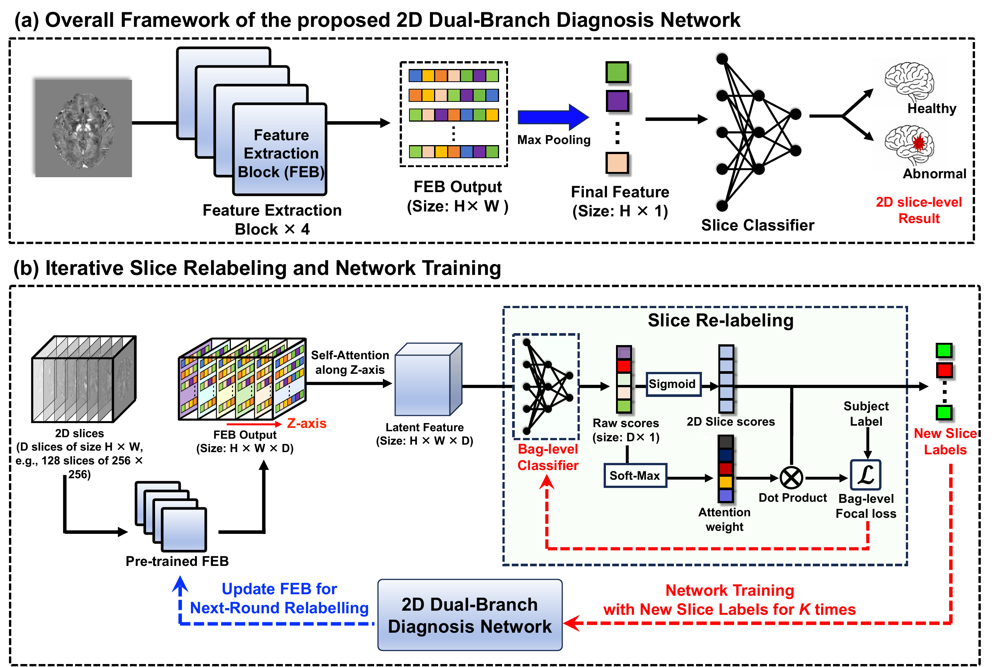
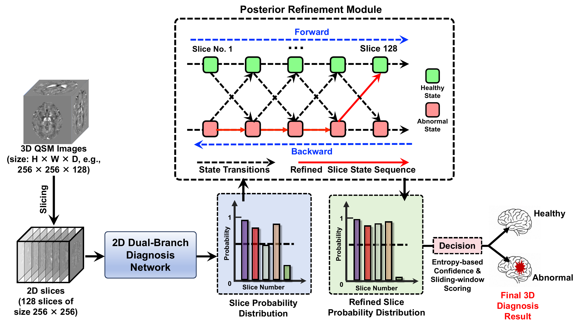
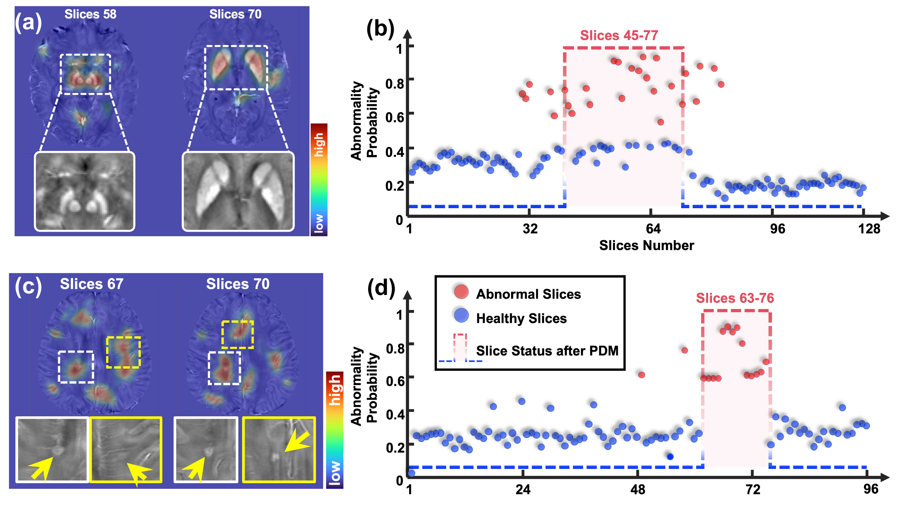

# PoRef-MIL: QSM Classification with Iterative Relabeling and Posterior Decision Modeling

[English](README.md) | **简体中文**

本仓库实现以 QSM 为主输入的 PoRef-MIL 分类流程，并保留多模态消融配置，结合全局与局部特征提取、轴向自注意力、迭代切片重标签及患者级后验决策模块（Posterior Decision Module, PDM），支持 PD/HC 与 MS/HC 实验。

## 🔬 Abstract

患者级疾病标签不能直接描述每一张 MRI 切片。PoRef-MIL 先通过 Transformer 与 CNN 的多分支结构提取切片特征，再沿 Z 轴建模切片上下文，并通过多轮预测更新训练切片的监督标签。最终，PDM 对有序切片概率执行一次 Forward–Backward 推断，结合 Shannon 熵、置信度及滑动窗口生成患者级分类与连续评分。

主要组成：

- **Multimodal MRI**：支持 QSM、T1w，以及按实验配置提供的其他已配准模态。
- **Global–Local Feature Extraction**：四个 Transformer/CNN 多分支块通过 Cross-Attention 融合特征。
- **Iterative Relabeling**：由独立重标签网络更新训练切片标签，再训练诊断网络。
- **Posterior Decision Module**：以双向后验和置信度加权窗口评分生成患者级决策。
- **Age-conditioned FiLM**：年龄经 sin/cos 编码及 MLP 生成缩放和偏移，支持在特征提取前或后调制输入/特征。

## 🏆 Results

PoRef-MIL 在 PD 数据集上取得 AUC **0.942±0.002**、ACC **0.926±0.008**；在 MS 数据集上取得 AUC **0.864±0.0029**、ACC **0.825±0.018**。完整对照结果与统计说明见 [Table 2](#table-2)。

## 🏗️ Architecture

### Network Components

1. **Feature Extraction**：每个模态通过四个多分支特征提取块，融合注意力全局特征和卷积局部特征。
2. **Multimodal Fusion**：默认使用跨模态 Cross-Attention，可切换其他融合方式进行消融。
3. **Axial Self-Attention**：仅在重标签网络中沿 Z 轴建立切片上下文，测试诊断网络不包含该模块。
4. **Slice Classification**：MLP 输出切片 logit，经 Sigmoid 得到疾病概率。
5. **Iterative Relabeling**：诊断网络初始化后，交替训练独立重标签网络和新的诊断网络；仅 FEB 权重从诊断网络传给下一重标签阶段。
6. **PDM**：单次 Forward–Backward、熵置信度和滑动窗口输出患者级结果。

```text
训练：患者标签 → 初始化诊断网络
     → 复制最佳 FEB → Z 轴注意力 → 重标签分类头
     → Sigmoid 切片概率 + Softmax 切片权重 → 患者 Focal Loss
     → 训练切片新标签 → 重新初始化并训练诊断网络 → 下一轮

测试：QSM → 有序切片 → 四级 FEB → 最大池化 → MLP
     → 切片疾病概率 → 一次双向后验细化 → 熵与置信度
     → 置信度加权窗口评分 → 最大窗口评分 → 患者诊断
```

### Key Features

- 患者级训练、验证、测试隔离，并检查跨集合患者及影像路径泄漏。
- 固定独立测试集，开发集内部五折训练/验证，分别评价五个模型。
- 单模态、双模态及可配置多模态输入。
- 支持 128 张 PD 切片、96 张 MS 切片及显式指定的其他序列长度。
- K=1–5 总训练轮数、融合方式、年龄位置和 PDM 消融。
- 保存患者名单、模型、伪标签、切片概率、后验、ROC 与逐折指标。

## 📁 Project Structure

```text
PoRef-MIL/
├── feature_ex/
│   ├── upper.py                 # 线性 token 化与 Transformer 分支
│   ├── middle.py                # Token 到二维特征图转换
│   ├── lower.py                 # CNN 与 DenseFeatureConvBlock
│   ├── crossAttention.py        # 多头交叉注意力
│   ├── feature.py               # 四块特征提取骨干
│   └── film.py                  # 年龄 Sin/Cos Encoding + FiLM
├── classifier/
│   ├── classifier_model.py      # 共享 MLP 分类头
│   ├── classifierNet.py         # 历史单模态切片网络
│   └── postProcess.py           # PDM 兼容入口
├── relabel/
│   ├── selfAttention.py         # 分块 Z 轴自注意力
│   ├── relabelingNet.py         # 单模态重标签参考网络
│   ├── relabelTrain.py          # 转接统一主实验入口
│   └── relabelTrainPP.py        # 转接统一主实验入口
├── poref/
│   ├── cli.py                   # 命令解析、参数校验与分派
│   ├── data.py                  # 患者划分检查及有序多模态读取
│   ├── model.py                 # PoRef-MIL 主模型与融合消融
│   ├── experiment.py            # 五折、K 轮训练及评价
│   ├── pdm.py                   # Forward–Backward 与窗口决策
│   ├── postprocess.py           # 已有切片概率 CSV 的独立 PDM
│   ├── inference.py             # 新主模型的无标签患者推理
│   ├── preprocessing.py         # 已配准影像的物理网格重采样
│   └── metrics.py               # 指标、ROC 与 mean/std 汇总
├── examples/
│   └── splits.template.json     # 固定测试集 + 开发集五折模板
├── tests/                       # 模块和流程测试
├── train_val.py                 # 训练脚本入口
├── requirements.txt             # 依赖列表
├── pyproject.toml               # 安装配置与 poref 命令
├── DESIGN_IMPLEMENTATION.md     # 设计落实与实现边界
└── README.md
```

目录树展示主流程相关文件。仓库中保留的历史切片训练脚本不等同于完整 PoRef-MIL 主实验；下文统一使用 `--mode poref`。

## 🚀 Getting Started

### Prerequisites

- Python **3.10 或以上**。
- PyTorch **2.4 或以上**；GPU 训练需配置与运行环境匹配的 PyTorch/CUDA。
- NumPy、NiBabel、SciPy、scikit-learn、pandas、tqdm。

在项目根目录执行：

```powershell
# 创建并启用环境（示例）
conda create -n poref-mil python=3.10
conda activate poref-mil

# 按目标设备配置好 PyTorch 后安装项目及依赖
python -m pip install -e .

# 查看命令
python train_val.py --help
python -m poref --help
```

安装后也可以使用 `poref train`、`poref predict` 和 `poref postprocess`。

### Data Preparation

#### 1. Image Modalities

| 实验 | 输入模态 | 标签 |
|---|---|---|
| PD 单模态 | QSM 或 T1w | HC=0，PD=1 |
| PD 双模态 | QSM + T1w | HC=0，PD=1 |
| MS | 根据实际实验配置 T1w、FLAIR、QSM 等 | HC=0，MS=1 |

模态名称通过 `--modalities` 指定，必须与划分文件中 `images` 的键完全一致。多模态的顺序也是模型配置的一部分。

#### 2. Data Format and Preprocessing

- 输入格式：NIfTI（`.nii` 或 `.nii.gz`）。
- 每个模态的单张切片：`[1,256,256]`；单模态序列：`[Z,1,256,256]`。主模型实际输入将 M 个模态堆叠为 `[Z,M,1,256,256]`；输出为 Z 个切片 logit。
- 常用 PD 体积：`[256,256,128]`；MS 可使用 96 张切片。
- `slice_axis=2` 对应 `[256,256,Z]`；`slice_axis=0` 对应 `[Z,256,256]`。
- 同患者各模态必须事先完成空间配准，具有一致的三维形状和 affine。读取器会检查网格一致性，但不执行影像配准或判断解剖配准质量。
- 读取时按患者、按模态执行体积级 Z-score，保留原始 Z 轴顺序。

如果已配准影像需要调整网格，可另存到新的输出目录：

```powershell
python -m poref preprocess --input-dir "D:/MRI/registered" --output "D:/MRI/resampled" --shape 256 256 128
```

此命令进行线性重采样并更新 affine；输出目录须为空且位于输入目录树之外，不覆盖源影像。可通过 `--reference` 指定共同参考网格；它不能替代空间配准。

#### 3. Fixed Test Set and Five-Fold Development Splits

本项目的五折方案为：**先固定独立测试集，再对剩余开发集做五折训练/验证**。

| 模型 | 训练部分 | 验证部分 | 测试部分 |
|---|---|---|---|
| Model 1 | B + C + D + E | A | 固定测试集 T |
| Model 2 | A + C + D + E | B | 固定测试集 T |
| Model 3 | A + B + D + E | C | 固定测试集 T |
| Model 4 | A + B + C + E | D | 固定测试集 T |
| Model 5 | A + B + C + D | E | 固定测试集 T |

A–E 是患者级开发集的五份。各模型按验证集选择权重，完成最后一轮训练后分别测试同一个 T。测试患者始终不参与训练。

主训练入口强制使用 `fixed_holdout` 和五个开发集训练／验证折，五个模型分别测试同一固定测试集。其它划分协议在主入口中会被拒绝。

#### 4. Patient Split File

复制并编辑 `examples/splits.template.json`，填写真实患者和路径。模板包含 10 个开发患者、2 个固定测试患者，仅用于展示结构，**不是实际实验数据或人数**。

划分文件采用 JSON；下面仅为字段示意，不能直接训练：

```json
{
  "test_design": "fixed_holdout",
  "samples": [
    {
      "patient_id": "subject_id",
      "label": 1,
      "images": {
        "QSM": "D:/MRI/QSM/subject.nii",
        "T1w": "D:/MRI/T1w/subject.nii"
      },
      "slice_axis": 2,
      "age": 65
    }
  ],
  "folds": [
    {
      "train": ["training_patient_ids"],
      "val": ["validation_patient_ids"],
      "test": ["fixed_test_patient_ids"]
    }
  ]
}
```

要求：

- 填入所有患者及完整的五组划分，每折 train/val/test 覆盖所有患者且互不重叠。
- 五个验证集合互斥，并恰好覆盖开发集一次；五个测试集合完全相同。
- 每个集合均包含两类患者；同一影像不能以不同患者 ID 跨集合复用。
- 影像可使用绝对路径，或相对于 JSON 所在目录的相对路径。
- 年龄实验必须提供每位患者的 `age`；其他实验可省略。

### Training

以下 PowerShell 命令训练 QSM 主模型。命令中的窗口长度为 5、判定阈值为 0.6；运行时填写实验使用的路径、窗口长度和阈值。窗口参数使用训练集或验证集选择，测试集用于最终评价。

```powershell
# QSM PoRef-MIL：固定测试集，开发集五折，K=5
python train_val.py `
  --mode poref `
  --data_split_file "D:/splits/pd.json" `
  --modalities QSM `
  --save_dir "D:/results/pd_k5" `
  --batch_size 1 `
  --slice-batch-size 4 `
  --learning_rate 0.0001 `
  --num_epochs 300 `
  --num_folds 5 `
  --rounds 5 `
  --window-length 5 `
  --window-threshold 0.6 `
  --expected-slices 128 `
  --seed 2025 `
  --std-ddof 1 `
  --device auto
```

同一命令也可写为 `poref train ...`。添加 `--dry-run` 仅查看参数解析，不导入模型、不读取影像、不启动训练；它不验证真实文件或划分内容。

`--batch_size` 表示每次优化累计的**患者数**，每位患者的有序序列单独前向/反向。`--slice-batch-size` 表示 FE 内部每次处理的切片数，两者含义不同。每个独立实验使用不同的空输出目录。

如需检查方案中的固定测试人数，可额外指定：

```text
PD: --expected-test-counts 26 31
MS: --expected-test-counts 20 20
```

参数顺序为 **HC、疾病类**；这只是核对测试集人数，不代表完整数据规模，也不会生成或更改患者划分。

### Testing

#### Evaluation during Training

每个模型完成最终诊断训练轮次后，会自动评价该折验证集及固定测试集。输出示例：

```text
pd_k5/
├── config.json
├── resolved_splits.json
├── fold_1_test_results.csv
├── fold_1_val_results.csv
├── fold_1/
│   ├── split.json
│   ├── best_round_1.pth
│   ├── best_round_5.pth
│   ├── best_relabel_for_round_2.pth
│   ├── best_relabel_for_round_5.pth
│   ├── pseudo_labels_for_round_2.json
│   ├── training_log.json
│   ├── patient_predictions.json
│   └── metrics.json
├── fold_2/ ... fold_5/
└── summary.json
```

目录树省略了其他轮次和折的同类文件。`summary.json` 汇总五个模型在同一测试集上的指标，并记录独立测试人群数为 1、未执行预测集成。

#### Prediction on Unlabelled Patients

```powershell
python -m poref predict `
  --checkpoint "D:/results/pd_k5/fold_1/best_round_5.pth" `
  --patients-file "D:/splits/unlabelled.json" `
  --output "D:/results/predictions_model1" `
  --device auto
```

`unlabelled.json` 只需 `samples` 列表，每名患者提供 `patient_id`、`images`、`slice_axis`，年龄模型另需 `age`；不需要标签或 folds。预测使用 checkpoint 保存的模型、模态、轮次、FiLM 及 PDM 配置，输出 `predictions.json`。

该命令一次加载一个模型。分别评价五个模型时，应使用五个 checkpoint 和不同输出目录。

#### Standalone PDM

对已有的有序切片概率执行相同 PDM：

```powershell
python -m poref postprocess `
  --input-dir "D:/results/slice_predictions" `
  --output "D:/results/pdm" `
  --folds 5 `
  --window-length 5 `
  --window-threshold 0.6 `
  --std-ddof 1
```

输入 CSV 需包含 `patient_name,true_label,slice_probs`。每个模型自动识别 `fold_N_test_results.csv` 或 `fold_N_test_slice_results.csv`；同一模型两种文件同时存在时会拒绝处理，需先整理明确的输入目录。新格式中的 `z_indices` 如存在，必须为连续原始顺序。

### Key Parameters

| 参数 | 默认值/要求 | 说明 |
|---|---|---|
| `--mode` | 必填 | 完整主流程使用 `poref` |
| `--data_split_file` / `--split-file` | 主流程必填 | 患者级划分 JSON |
| `--save_dir` / `--output` | 必填 | 新的空输出目录 |
| `--modalities` | `QSM` | 有序模态名称，如 `QSM T1w` |
| `--batch_size` | `8` | 每次优化累计患者数；上面的示例显式使用 1 |
| `--slice-batch-size` | `4` | FE 内部切片批大小 |
| `--learning_rate` | `0.0001` | 第一轮学习率，并按比例缩放默认轮次学习率 |
| `--num_epochs` | `300` | 每个诊断或重标签训练阶段的最大 epoch 数 |
| `--num_folds` | `5` | 主流程要求 JSON 包含固定测试集及五个开发集训练／验证折 |
| `--rounds` | `5` | K 轮诊断训练（含初始化），对应 K−1 次重标签，可选 1–5 |
| `--round-lrs` | 默认轮次序列 | 可显式提供与 K 等长的学习率列表 |
| `--patience` | `50` | 验证 AUC 早停耐心值 |
| `--weight-decay` | `0.00001` | Adam 权重衰减 |
| `--alpha` / `--gamma` | `0.5` / `2.0` | Focal Loss 参数 |
| `--relabel-threshold` | `0.5` | 训练切片离散标签阈值 |
| `--fusion` | `cross-attention` | 融合方式 |
| `--age-position` | `none` | `none`、`pre` 或 `post` |
| `--supervision` | `iterative` | 迭代监督或 `traditional-mil` 均值监督消融 |
| `--aggregation` | `pdm` | 患者级 PDM 或 `mean` 聚合 |
| `--window-length` | PDM 必填 | 滑动窗口 L，不能超过切片数 |
| `--window-threshold` | PDM 必填 | 患者决策阈值 T_w |
| `--stay-hc` / `--stay-disease` | `0.9` / `0.9` | PDM 状态自保持概率 |
| `--prior-hc` | `0.5` | PDM 初始 HC 概率 |
| `--expected-slices` | 不限制 | 核对序列长度，如 128 或 96 |
| `--expected-test-counts` | 不限制 | 核对每个模型的 HC、疾病测试人数 |
| `--disease-name` | `PD` | 实验记录使用 `PD` 或 `MS` |
| `--seed` | `2025` | 第一个模型的随机种子，后续模型依次加 1 |
| `--std-ddof` | `1` | 样本标准差；可显式选择 0 |
| `--device` | `auto` | `auto`、`cpu`、`cuda` |
| `--dry-run` | 关闭 | 只预览参数 |

PDM 的健康和疾病状态自保持概率均默认为 0.9，初始健康概率默认为 0.5，均由命令行参数配置。窗口长度和判定阈值运行时必填，使用训练集或验证集选择。

## 🔧 Model Architecture Details

### 1. Global–Local Feature Extraction

每个模态串联四个 Extraction Block：

- **Upper branch**：行向量线性 token 化得到 256 个 256 维 token，经过两组 LayerNorm、自注意力、MLP 和残差连接。
- **Middle branch**：从第一个注意力前馈模块后分叉，经过 LayerNorm、重排和 1×1 卷积，得到 `[128,16,16]` 特征图。
- **Lower branch**：四组 3×3 Conv、BatchNorm、ReLU、MaxPool；与中间分支拼接，再经过 DenseFeatureConvBlock 和通道变换。
- **Cross-Attention**：上分支为 Q，下分支为 K/V；归一化和多头交叉注意力后接残差连接、LayerNorm、GELU 前馈 MLP 和第二次残差连接，输出 `[256,256]` 特征。

四块 CNN 分支始终接收原图，后续块的 token 输入来自前一块。

### 2. Axial Self-Attention

Z 轴自注意力仅用于重标签网络，对特征矩阵的每个对应位置，沿完整 Z 张切片交换上下文：标量特征经 `1→64` 投影，执行 8 头自注意力、残差连接和 `64→128→64` 前馈网络，再投影回标量。输入与输出均为 `[1,Z,N,256]`，N=256；MLP-level 融合将融合向量的每个分量沿末维复制，保持同样的矩阵尺寸。实现按独立特征位置分块，不切断 Z 轴序列，并在训练时使用梯度重计算控制中间激活占用。

### 3. Slice Classifier

诊断分类头接收 FEB 输出；重标签分类头接收 Z 轴注意力输出。二者均沿每个 token 的特征维执行最大池化（`[Z,256,256] → [Z,256]`），再通过独立参数的同结构 MLP：

```text
256 → 512 → 1024 → 512 → 256 → 128 → 2 → 1
```

每个隐藏线性层后使用 ReLU，最后一层输出 logit，再经 Sigmoid 转换为疾病概率。MLP-level 融合将 256 维向量的每个分量沿末维复制，最大池化后保留原融合向量；该分支用于融合消融。

### 4. Iterative Relabeling



**图 1｜网络与迭代重标签。** 切片经过四个特征提取块得到分类特征；Z 轴注意力结合切片上下文生成预测标签，再用于后续轮次训练，逐步更新切片监督。[查看原始 PDF](docs/figures/figure-1-framework.pdf)。

1. **Round 1**：训练患者标签初始化切片标签，训练诊断网络（四级 FEB→最大池化→MLP），保存最佳患者级验证 AUC checkpoint。
2. **Round 2–K 的重标签阶段**：复制上一轮最佳诊断 FEB 至独立重标签网络，重新初始化 Z 轴注意力及分类头。FEB 不冻结。同一组 logits 经 Sigmoid 得到切片概率，经 Softmax 得到切片权重，点积形成患者概率，再计算患者标签的 Focal Loss。用患者级聚合概率的验证 AUC 选重标签 checkpoint。
3. 载入最佳重标签 checkpoint，仅为训练患者生成切片标签（Sigmoid 概率≥0.5，阈值可配置）。
4. 重新初始化整个诊断网络，以新切片标签训练；切片 Focal Loss 在每名患者内部取均值。诊断验证评分使用所选聚合方式（默认 PDM），其最佳 FEB 提供给下一重标签阶段。测试仅使用最终诊断网络及 PDM。

`--rounds 5` 表示一次初始化加四次重标签／诊断训练。每阶段独立创建 Adam、ReduceLROnPlateau 和早停状态。每轮重标签阶段与该轮诊断阶段使用相同的学习率、最大 epochs 和早停规则。诊断网络与重标签网络分别训练并保存 checkpoint。

验证和测试始终使用真实患者标签评价，不进入伪标签更新。伪标签以切片概率 `>= --relabel-threshold` 离散化（默认阈值 0.5）。当 K=5 且第一轮学习率 `--learning_rate=1e-4` 时，各轮初始学习率为：

```text
[1e-4, 5e-5, 3e-5, 1e-5, 5e-6]
```

K<5 时取前 K 项；改变 `--learning_rate` 会同比例缩放该序列。可用 `--round-lrs` 显式覆盖，必须提供恰好 K 个值。每个阶段重新创建优化器与学习率调度器，载入该轮最佳验证权重后再进入下一轮。

### 5. Posterior Decision Module



**图 2｜后验决策流程。** 将有序切片概率输入 HC/疾病两状态模型，经一次 Forward–Backward 得到双向后验，再结合熵置信度与滑动窗口生成患者级诊断。图中的状态连接表示转移关系；后验细化采用前向—后向递推。[查看原始 PDF](docs/figures/figure-2-pdm.pdf)。

对原始有序切片疾病概率执行**一次** Forward–Backward，获得疾病后验 q_i。

```math
H_i=-q_i\log_2q_i-(1-q_i)\log_2(1-q_i)
```

```math
C_i=1-H_i
```

在长度为 L 的窗口中，以置信度为权重对疾病后验取加权平均：

```math
W_j=\frac{\sum_{i=j}^{j+L-1} C_iq_i}{\sum_{i=j}^{j+L-1} C_i}
```

```math
S=\max_j W_j
```

窗口步长为 1，不补零。置信度总和为零的窗口无有效评分，在输出中标记为 `null`，不参与最大值选择；若所有窗口均无效，程序报错，不自动判为健康。
当 `S > T_w` 时判为疾病，否则为 HC；S 用于患者级 ROC-AUC。训练验证、测试、predict 和独立后处理使用同一公式。
PDM 不使用硬切片标签加权，不执行 Viterbi、额外低通滤波或重复 Forward–Backward。

#### Slice-level Visualization



**图 4｜切片与序列决策示例。** 上、下两组分别展示 128 张和 96 张切片序列中的代表性影像、异常概率及 PDM 标出的连续异常区间，用于说明局部影像与序列决策的对应关系。[查看原始 PDF](docs/figures/figure-4-visualization.pdf)。

图中热图为论文图示。`heatmap` 脚本将切片概率广播到整张切片，输出属于切片级可视化。

### 6. Age-conditioned FiLM

年龄协变量通过 **Sinusoidal Encoding（正弦/余弦编码）+ FiLM** 引入。实现位于 `feature_ex/film.py`，调用位置由 `poref/model.py` 的 `--age-position` 配置决定。

#### Sin/Cos Age Encoding

设患者年龄为 a（单位：岁），编码维数 d=256。先计算归一化年龄 u=a/100，再使用 128 个固定频率，将 sin 与 cos 交错拼接为 256 维年龄向量：

```math
u = \frac{a}{100},\qquad
\omega_j = \exp\!\left(-\frac{j\ln 10000}{128}\right),\qquad j=0,\ldots,127
```

```math
e_{2j}(a)=\sin(u\omega_j),\qquad
e_{2j+1}(a)=\cos(u\omega_j)
```

编码顺序为 `[sin(uω₀), cos(uω₀), …, sin(uω₁₂₇), cos(uω₁₂₇)]`。频率固定、不参与训练；a/100 是固定缩放，不是依据数据集均值和方差进行标准化。

#### FiLM Parameter Generation and Modulation

年龄向量经过可训练 MLP，生成 C 个缩放参数与 C 个偏移参数：

```text
256 → Linear(256, 256) → GELU → Linear(256, 2C) → split(γ, β)
```

```math
[\gamma(a),\beta(a)] = \mathrm{MLP}(e(a)),\qquad
\widetilde{F} = (1+\gamma(a))\odot F + \beta(a)
```

γ、β 沿通道调制，在其余维度广播。同一患者的年龄向量复用于其全部切片。MLP 最后一层的权重和偏置初始化为零，使初始 γ=β=0，FiLM 起始为恒等变换；编码后的 MLP 随分类任务联合训练。

| 配置 | 实际调用顺序 | 调制通道数 C |
|---|---|---|
| `--age-position none`（默认） | 不启用年龄编码和 FiLM | 不适用 |
| `--age-position pre` | 体积标准化 → Sin/Cos 年龄编码生成 γ、β → 调制各模态输入切片 → FE → 模态融合 → 分类头（仅重标签阶段在分类前加入 Z 轴注意力） | 输入模态数 M |
| `--age-position post` | FE → 模态融合 → 使用 Sin/Cos 年龄编码生成的 γ、β 调制特征 → 分类头（仅重标签阶段在分类前加入 Z 轴注意力） | 特征维度 256 |

Pre-FE 对每个输入模态使用一个缩放与偏移，并在切片像素上广播。Post-FE 对 256 维特征通道调制，并在 token 上广播；采用 decision-level 融合时，同一个 FiLM 分别用于各模态特征，随后使用共享分类头并平均概率；轴向注意力仅用于重标签网络。

Pre-FE 与 Post-FE 分别独立训练和评估。每个启用年龄的模型仅有一个共享 FiLM，不会同时启用两种位置；所有训练、验证、测试及推理患者都必须提供有限的 `age`，范围为 0–120 岁。默认训练示例使用 `none`；进行年龄实验时，在完整训练命令中添加 `--age-position pre` 或 `--age-position post`，并为每个实验选择独立输出目录。

### Loss Function

诊断网络逐切片计算 Binary Focal Loss，再在每名患者内部取平均；重标签网络先聚合切片概率，再与患者标签计算 Focal Loss。两者使用 `alpha=0.5`、`gamma=2.0`。

两个训练阶段分别创建 Adam，权重衰减为 `1e-5`，最多训练 300 epochs。ReduceLROnPlateau 以验证 AUC 为依据，factor 为 0.5、patience 为 10、最低学习率为 `1e-7`。验证 AUC 相对最佳保存值增加超过 `1e-4` 时更新 checkpoint；连续 50 epochs 未达到该提升时早停。这些参数由对应运行配置控制，调度器设置由训练代码指定。

重标签阶段以注意力聚合后的患者概率计算验证 AUC；诊断阶段以 PDM 的最大置信度加权窗口评分计算验证 AUC。`--aggregation mean` 消融使用患者切片概率均值。

均值 MIL 消融使用同一基础网络，将切片概率均值转换为患者级预测，再使用真实训练患者标签计算 Focal Loss。

## 📊 Experimental Results

### Evaluation Protocol

本项目运行时分别评价五个训练/验证折产生的模型，测试集患者固定不变，记录以下内容。下述 `--std-ddof` 是代码运行配置；Table 2 的数值按作者原表报告，未据此重新计算：

- **AUC、ACC、SEN、SPE、PRE、F1**，及 ROC 曲线数据。
- **TP、FN、FP、TN**，混淆矩阵排列固定为 `[[TP,FN],[FP,TN]]`。
- 逐模型患者名单、真实标签、连续分数、预测及切片概率。
- 使用同一 `--std-ddof` 计算 mean ± std；默认 `ddof=1`。

标准差描述五个模型在同一测试集上的性能波动，不能解释为五个独立测试人群之间的波动。未定义的指标保存为 `null`。

### Performance Comparison

<a id="table-2"></a>

**Table 2. Comparison of the Proposed PoRef-MIL with Other Methods on PD and MS Datasets**

以下为作者提供的真实实验结果，数值按原始 Table 2 保留。

#### PD Dataset

| Method | AUC | ACC | SEN | SPE | PRE | F1 Score |
|---|---|---|---|---|---|---|
| AG-SE-ResNeXt | 0.893±0.002 | 0.846±0.015 | 0.858±0.018 | 0.831±0.021 | 0.858±0.016 | 0.858±0.014 |
| CAAE-CRATNet | 0.901±0.002 | 0.867±0.010 | 0.865±0.014 | 0.869±0.021 | 0.888±0.015 | 0.876±0.009 |
| MMRNNet | 0.899±0.002 | 0.860±0.012 | 0.832±0.014 | 0.892±0.032 | 0.903±0.025 | 0.866±0.010 |
| DenseFormer-MoE | 0.906±0.001 | 0.856±0.015 | 0.813±0.014 | <ins>0.908±0.021</ins> | 0.913±0.019 | 0.860±0.014 |
| DA-MIDL | 0.914±0.002 | 0.867±0.010 | 0.865±0.014 | 0.869±0.021 | 0.888±0.015 | 0.876±0.009 |
| TransMIL | <ins>0.927±0.001</ins> | <ins>0.898±0.008</ins> | <ins>0.890±0.018</ins> | <ins>0.908±0.021</ins> | <ins>0.920±0.016</ins> | <ins>0.905±0.008</ins> |
| PoRef-MIL | **0.942±0.002** | **0.926±0.008** | **0.923±0.018** | **0.931±0.017** | **0.941±0.014** | **0.932±0.008** |

#### MS Dataset

| Method | AUC | ACC | SEN | SPE | PRE | F1 Score |
|---|---|---|---|---|---|---|
| AG-SE-ResNeXt | 0.774±0.0029 | 0.735±0.014 | 0.780±0.027 | 0.690±0.022 | 0.716±0.013 | 0.746±0.015 |
| CAAE-CRATNet | 0.805±0.0033 | 0.760±0.014 | 0.780±0.027 | 0.740±0.022 | 0.750±0.014 | 0.765±0.015 |
| MMRNNet | 0.795±0.0027 | 0.745±0.021 | 0.770±0.027 | 0.720±0.027 | 0.734±0.022 | 0.751±0.021 |
| DenseFormer-MoE | 0.778±0.0025 | 0.730±0.011 | 0.760±0.022 | 0.700±0.035 | 0.718±0.020 | 0.738±0.009 |
| DA-MIDL | 0.803±0.0025 | 0.760±0.014 | 0.790±0.022 | 0.730±0.027 | 0.746±0.017 | 0.767±0.013 |
| TransMIL | <ins>0.829±0.0029</ins> | <ins>0.795±0.011</ins> | <ins>0.820±0.027</ins> | <ins>0.770±0.027</ins> | <ins>0.781±0.017</ins> | <ins>0.800±0.012</ins> |
| PoRef-MIL | **0.864±0.0029** | **0.825±0.018** | **0.850±0.035** | **0.800±0.035** | **0.810±0.025** | **0.829±0.018** |

**统计说明：** 数值为在开发集内部进行五折训练/验证得到的五个模型的 mean ± standard deviation；五个模型分别评价同一个固定测试集。加粗表示各数据集内该指标的最高均值，下划线表示第二高均值，并列值使用相同标记。

PoRef-MIL 在 PD 和 MS 数据集上的六项指标均取得表中最高均值。PD 的 AUC、ACC 分别为 **0.942±0.002**、**0.926±0.008**；MS 的 AUC、ACC 分别为 **0.864±0.0029**、**0.825±0.018**。

AUC：ROC 曲线下面积；ACC：准确率；SEN：敏感度；SPE：特异度；PRE：精确率；F1 Score：精确率与敏感度的调和平均。表中比较方法仅用于报告对照结果。

运行本项目后，可从 `summary.json` 查看该次运行的汇总指标；完成标记为 `status: complete`。Table 2 保留论文报告值，不由命令示例或软件测试生成。

### Ablation Studies

| 实验因素 | 配置方式 |
|---|---|
| 单/双模态 | `--modalities T1w`、`QSM`、`QSM T1w` |
| 融合位置 | `--fusion decision-level`、`mlp-level`、`concatenation`、`cross-attention` |
| 诊断训练总轮数 | `--rounds 1` 至 `--rounds 5`，分别独立训练 |
| 无 PDM | `--aggregation mean`，均值概率及 0.5 阈值 |
| 初始标签与迭代更新 | `--rounds 1` 与多轮 `iterative` 配置 |
| 均值 MIL 监督 | `--supervision traditional-mil --rounds 1` |
| 年龄位置 | `--age-position pre` 与 `--age-position post` |

融合定义：Decision-level 为各模态经过共享分类头后的概率平均，重标签阶段在分类前加入 Z 轴注意力；MLP-level 为各模态 token 池化后拼接并经 MLP 融合；Concatenation 为 token 特征拼接后线性降维；Cross-Attention 为跨模态注意力融合；双模态时先计算以第一模态为 Q、第二模态为 K/V 的共享交叉注意力结果，分别与两模态残差相加并归一化，再做第二次交叉注意力与残差归一化。多于两个模态时按 `--modalities` 顺序逐个融合。

K=1–5 消融需使用相同真实划分、相同种子配置和不同输出目录，分别独立训练。PDM 主实验额外保存同一最终模型、同一份切片预测的均值聚合指标，便于隔离后处理因素。

## 🧠 Prediction Interpretability

主流程导出原始切片概率、双向后验、Shannon 熵、置信度、窗口置信度总和、窗口评分、有效状态及最高评分窗口的位置，用于追踪患者决策对应的连续切片。

这些输出属于**切片序列层面**的解释。历史 heatmap 脚本将切片概率广播到整张切片，不提供像素级病灶定位；它仅适用于旧切片模型，不能加载新主模型 checkpoint。

## 📂 Additional Resources

- [患者级五折划分模板](examples/splits.template.json)
- [设计落实与实现边界](DESIGN_IMPLEMENTATION.md)
- [依赖列表](requirements.txt)
- [安装配置](pyproject.toml)


## 图示结构的 checkpoint 格式

checkpoint 保存 `format_version=2`，角色为 `diagnosis` 或 `relabel`。
`predict` 仅接受诊断 checkpoint。旧的 FE1/FE2 联合轴向网络权重不适用于
新结构，需要重新训练。`best_round_K.pth` 是诊断权重；
`best_relabel_for_round_K.pth` 用于生成训练切片伪标签。
完整主入口是 `poref train --mode poref`；旧模式及旧 heatmap 权重接口保留为兼容用途。
